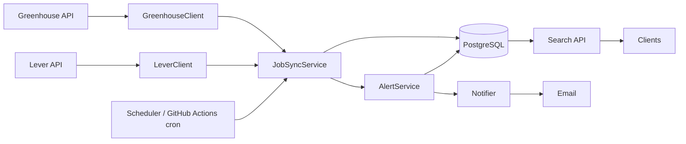

# JobRadar

[](https://github.com/barakes/JobRadar/actions/workflows/ci.yml)

A backend service that aggregates job postings from public applicant-tracking systems,
keeps them in sync on a schedule, offers full-text search with country and location filters,
and sends email alerts when new jobs match a saved search.

**Live API docs:** https://jobradar-3wmg.onrender.com/swagger-ui.html
*(Free hosting: the first request after a period of inactivity can take about 2 minutes while the server wakes up.)*

Try it: open the docs, expand `GET /api/jobs`, click **Try it out**, and search for `engineer` with country `israel`.

---

## Features

- **Multiple job sources** – Greenhouse and Lever public job-board APIs. Each source is a single class; adding one requires no changes to the sync logic.
- **Scheduled sync** – new jobs are created, existing ones updated, and jobs that disappear from the source are marked as closed (and reopened if they come back).
- **Deduplication** – enforced both in code and by a database unique constraint.
- **Full-text search** – PostgreSQL `tsvector` with a GIN index, supporting web-search syntax (`backend -senior`, `"exact phrase"`).
- **Country detection** – companies write locations differently ("Tel Aviv", "Israel", "Petah Tikva"); each job gets a normalized country, so one filter finds them all.
- **Saved searches with email alerts** – after each sync, every saved search is checked for new matching jobs, and a summary email is sent. The same job is never sent twice, and a failed email is retried on the next run.
- **Pagination** with a capped page size.
- **Admin API key** protecting every endpoint that changes data, and every endpoint that exposes personal data (saved searches contain emails). Job search stays public.
- **Interactive API documentation** with OpenAPI / Swagger UI.

## Tech stack

| Area | Technology |
|---|---|
| Language | Java 25 |
| Framework | Spring Boot 4.1 (Web MVC, Data JPA, Validation) |
| Database | PostgreSQL 18, Flyway migrations |
| HTTP client | Spring `RestClient` with timeouts |
| Email | Resend HTTP API |
| Docs | springdoc-openapi (Swagger UI) |
| Tests | JUnit 6, AssertJ, Testcontainers |
| CI/CD | GitHub Actions |
| Hosting | Docker on Render, database on Neon |

## Architecture



## Design decisions

- **Network calls happen outside database transactions.** Fetching from an external API can take seconds; holding a database connection during that time could exhaust the connection pool. Jobs are fetched first, then saved in a short transaction.
- **Strategy pattern for sources and notifications.** All `JobSourceClient` implementations are injected as a list and mapped by source type, so a new source is just a new class (open/closed principle). Alerts go through a `Notifier` interface, so the delivery channel can change without touching the alert logic.
- **Failure isolation.** One failing source or email is logged and skipped; the others continue. All outgoing HTTP calls have connect and read timeouts.
- **No overlapping runs.** `AtomicBoolean` locks ensure a scheduled sync and a manual one never run at the same time, and alerts are never sent twice in parallel.
- **At-least-once alerts.** A saved search remembers when it was last notified; that moment is updated only after the email was sent successfully, and is taken before querying so jobs added during a run are not lost.
- **Untrusted data is escaped.** Job titles and links come from external sources, so they are HTML-escaped before being put into emails, and only `http(s)` links are made clickable.
- **Encapsulated entities.** No setters; state changes go through methods like `refresh()`, `markClosed()` and `markNotified()`, and the country is always derived from the location.
- **DTOs instead of entities** in API responses, and a projection query that fetches only the columns a search result needs (no N+1 queries).
- **Constant-time key comparison** (`MessageDigest.isEqual`) to avoid timing attacks; secrets come only from environment variables.
- **Email over HTTPS instead of SMTP**, because the free hosting tier blocks outbound SMTP ports.
- **Waking a sleeping free-tier server.** A GitHub Actions cron job calls the sync endpoint every 6 hours, which both wakes the server and triggers a sync with alerts.

## API overview

| Method | Path | Auth | Description |
|---|---|---|---|
| GET | `/api/jobs?q=&country=&location=&page=&size=` | – | Search open jobs |
| GET | `/api/companies` | – | List tracked companies |
| POST | `/api/companies` | Admin key | Track a new company |
| POST | `/api/companies/{id}/sync` | Admin key | Sync one company |
| POST | `/api/sync` | Admin key | Sync all active companies and send alerts |
| GET | `/api/saved-searches` | Admin key | List saved searches |
| POST | `/api/saved-searches` | Admin key | Create a saved search with an alert email |
| DELETE | `/api/saved-searches/{id}` | Admin key | Deactivate a saved search |

Protected endpoints require the `X-Admin-Key` header.

## Running locally

Requirements: Java 25 and Docker.

```bash
# Start PostgreSQL
docker compose up -d

# Run the application
./mvnw spring-boot:run
```

Then open http://localhost:8080/swagger-ui.html.
Locally, the admin key is `local-dev-key`, and emails are only logged (set `RESEND_API_KEY` to really send them).

## Tests

```bash
./mvnw test
```

43 tests, including integration tests that run against a real PostgreSQL instance started by Testcontainers
(sync behavior, deduplication, closing and reopening jobs, full-text search, filters, pagination,
and alerts: matching, no duplicates, retries after failures, and HTML escaping).

## Roadmap

- Stemming in full-text search (e.g. `engineer` matching `engineering`)
- More sources (e.g. Comeet, popular with Israeli companies)